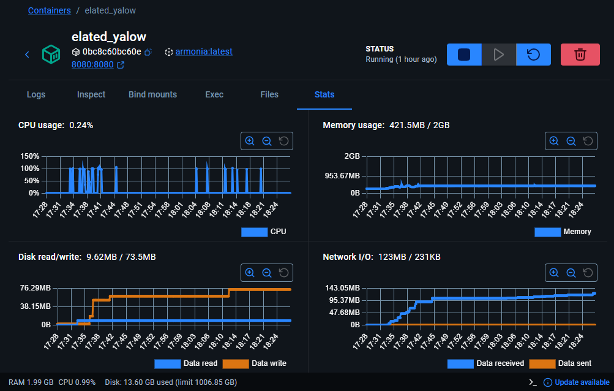

# Armonía

Automatic transcription of musical audio into MIDI, piano roll and sheet music.
FastAPI + Basic Pitch (ONNX runtime) backend; React frontend served by the same
container.

## Run locally

```bash
docker build -t armonia .
docker run --rm --name armonia-test -p 8080:8080 --memory 2g --cpus 1 armonia
```

Open `http://localhost:8080`. The limits (1 CPU, 2 GiB) mirror the Cloud Run
configuration.

## Local Performance Measurements

Two local runs with Docker, before the cloud deployment. **Run 1** used manual
timing only. **Run 2** added continuous `docker stats` logging (62 min,
1,482 samples, one every ~2.5 s) and is the reference for resource usage.

| Item             | Value                                                          |
| ---------------- | -------------------------------------------------------------- |
| Container limits | 1 CPU, 2 GiB                                                   |
| Engine           | Basic Pitch, ONNX Runtime (no TensorFlow)                      |
| Conversion queue | 1 at a time per instance, extra requests wait                  |
| Input limits     | 25 MB, 300 s                                                   |
| Client           | Browser at `localhost:8080` (MP3 upload, microphone recording) |
| Host machine     | _to be completed_                                              |
| Tested commit    | _to be completed_                                              |

### Conversion time

Seconds, measured manually from submission to result. Run 2 (reference), with
Run 1 in parentheses. Concurrent rows show the total time of the batch.

| Input                | 1 min   | 2 min   | 3 min   |
| -------------------- | ------- | ------- | ------- |
| MP3, 1 file          | 6 (7)   | 12 (13) | 15 (24) |
| MP3, 2 files at once | 13 (8)  | 22 (10) | 37 (25) |
| MP3, 3 files at once | 16 (15) | 28 (22) | 51 (35) |
| Microphone, melody   | 4 (1)   | 9 (6)   | 17 (10) |
| Microphone, silence  | 5 (7)   | 9 (5)   | 15 (9)  |

- Single files run at ~0.08–0.13 s per second of audio (7–12× faster than
  real time).
- Batch totals match the sum of per-file times within 2 s, consistent with the
  one-at-a-time queue.
- Silence takes about as long as music: cost depends on duration, not content.

### Input validation

| Input                 | Run 2                  | Run 1                  |
| --------------------- | ---------------------- | ---------------------- |
| Unsupported format    | rejected in < 1 s      | –                      |
| File over 25 MB       | rejected in < 1 s      | –                      |
| MP3 over 300 s        | 351 s, rejected in 4 s | 314 s, rejected in 4 s |
| Microphone over 300 s | 351 s, rejected in 3 s | 5 min, rejected in 1 s |

Format and size are checked before any processing. Duration is checked after
FFmpeg normalization, so those rejections take a few seconds but never reach
inference.

### Resource usage (Run 2)

| Metric    | Result                                                                                             |
| --------- | -------------------------------------------------------------------------------------------------- |
| Startup   | ~16 s at 100% CPU (model load + warm-up); memory 60 → 261 MiB                                      |
| CPU       | 0.25% idle on average; ≈100% (max 106%) only during conversions; 18 bursts, one per processed file |
| Memory    | 261 MiB idle → **502 MiB peak** (3 × 3 min batch) → 421 MiB idle after tests (25% of limit)        |
| Network   | 123 MB in / 231 KB out for the whole session                                                       |
| Block I/O | 9.6 MB read / 73.5 MB written, in bursts of 8–33 MB (temporary files)                              |
| Processes | 9 idle, up to 20 under load                                                                        |



### Findings

1. **Latency:** a 3-minute file converts in 15–24 s. Extrapolated to the
   300 s limit: about 25–40 s (not measured yet).
2. **Concurrency:** three simultaneous 3-minute files finish in 51 s, far
   below the 600 s Cloud Run timeout.
3. **Memory:** peak 502 MiB of 2 GiB. After the first heavy conversions the
   baseline settled at ~421 MiB and stayed flat for 45+ minutes and several
   further conversions, with no growth trend.
4. **Cold start:** ~16–19 s locally. The frontend calls `/health` on page load,
   which warms the instance before the first conversion.
5. **Variability:** the same 3-minute file took 15 s and 24 s in two runs, so
   treat times as ranges.
6. **Egress:** outbound traffic was negligible (< 0.25 MB per session).

### Free tier estimate (indicative)

30 test users × 20 conversions = 600 conversions × ~25 s ≈ 15,000 vCPU-s, plus
~300 cold starts × ~19 s ≈ 5,700 vCPU-s. Total ≈ 20,700 vCPU-s, about **12%** of
the 180,000 vCPU-s monthly allowance of Cloud Run request-based billing
(us-central1; verify current limits). With 1 vCPU and 2 GiB, the memory
allowance (GiB-s) is consumed at the same rate as CPU. Assumes Cloud Run
hardware performs like the local host.

### Limitations

- Two runs, manual timing; audio material was not strictly identical across
  scenarios.
- Mapping of CPU bursts to scenarios is inferred from timestamps.
- Local hardware only; Cloud Run performance and cold starts may differ.
- Earlier functional tests used the TensorFlow model; these use ONNX.

### Pending

- [ ] Time a file just under 300 s, and three of them at once, with peak memory.
- [ ] Repeat key scenarios 3× and report mean, min and max.
- [ ] Repeat on Cloud Run, including cold-start latency.
- [ ] Complete host machine and tested commit.
- [ ] Compare ONNX output against earlier TensorFlow results.
